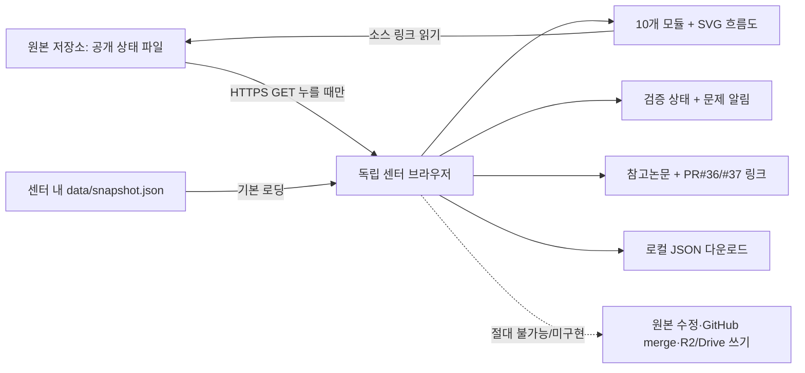

# 독립 프로젝트센터 구성 및 상태 계약

## 설계 원칙

`edwardlim1004/AI-project-center-interface-main`은 UI 독립 사이트이며 기존 `edwardlim1004/realestate_AI_anysis_20260927` 소스 시스템을 **수정하거나 병합하지 않습니다**. GitHub Pages의 정적 브라우저 앱이므로 인증, 서버 보관, 워크플로 원격 실행은 없습니다.

## 데이터 흐름

## 상태 정의

- `operating` (녹색): 이미 운영 중인 원본 참고/서비스 모듈. **이번 센터의 실시간 성공 신호가 아님**.
- `warning` (주황): 저장 범위 합계, 자료 신뢰성 등 조사 필요.
- `validation` (파랑): 검증 게이트 심사 중, 운영 위험점수 승격 금지.
- `research` (보라): 연구/Draft, 미검증 예측 확률 노출 금지.
- `failure` (빨강): 특정 Actions 실행의 실제 실패가 확인된 상태. 최신 회복 여부는 별도 확인.
- `prototype` (주황): 제품 구상/시제품으로 실물 서비스 연동 증거 부족.
- `review` (파랑): 운영/결재 정책 설계 Draft, 실제 승인 강제 기능 아님.

## 수집 범위 합계에 대한 규칙

Snapshot (2026-11-01): `total_completed_scopes=35344`; 서울 `11050` + 경기 `20774` + 대전 `2210` = `34034`. 차이는 `1310`. R2 `20781` + Google Drive `14563` = `35344`. 상이한 scope 정의 또는 분류 문제를 밝혀내지 못한 상태에서 **실제 자료 누락으로 단정하지 않음**.

## 확장 지침

실제 다중 AI와 연동하려면 인증된 API gateway, GitHub 최소권한 토큰, 읽기/쓰기 분리, 승인된 수동 Merge/검증 기록, 감사로그를 별도 서버에서 구성해야 합니다. GitHub Pages에 액세스 토큰을 저장하거나 개인 R2/Drive 키를 포함하지 마세요.

## 신규 저장소와 원본 연결

- Project Center UI: 새 독립 저장소 (`AI-project-center-interface-main`), 정적 GitHub Pages.
- Source of truth: 기존 저장소의 승인된 `main` 소스, 모델 산출물 및 관리 Draft PR.
- `PR #36`, `PR #37`: 원본 프로젝트의 작업 이력, 새 센터에 병합하지 않음.